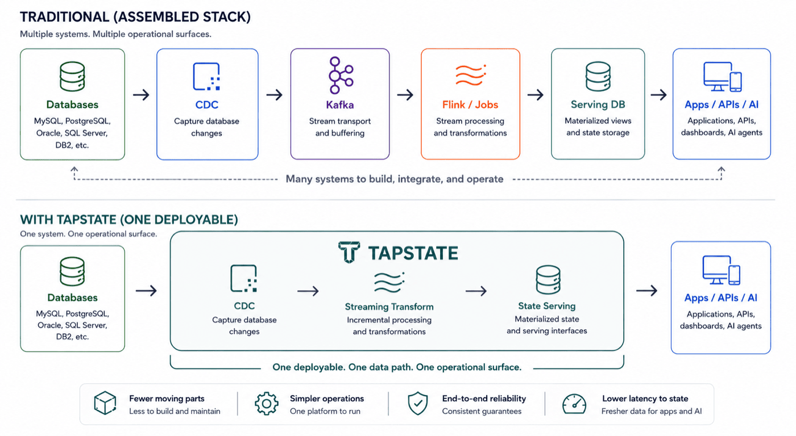

# tapstate

**Capture. Transform. Serve. One deployable.**

Tapstate is an open-source **unified operational data engine** that turns database
changes into live, application-ready state.

```text
Production databases → Capture → Transform → Live state → Apps / APIs / AI agents
```

Instead of assembling CDC, streaming, stream processing, and serving infrastructure,
Tapstate brings the source-to-state path under one product boundary.

Kafka moves events. Warehouses analyze history. Tapstate turns database truth into
live operational state.

## Why Tapstate



A typical operational data path chains a database, CDC, Kafka, Flink or custom jobs,
and a serving database before an application sees anything. Tapstate collapses that
into one deployable.

One data path. One operational surface.

- **Capture** database changes using log-based CDC.
- **Transform** and combine data incrementally as it changes.
- **Serve** application-ready state to applications, APIs, automation, and AI agents.

For how this compares with a streaming stack you assemble yourself, see
[Tapstate vs. a streaming stack](https://tapstate.dev/docs/overview/vs-streaming-stack).

## Try it

Start the playground. You need Docker with the Compose plugin; the script starts MySQL,
PostgreSQL, MongoDB and Tapstate, then keeps a live order object assembled from both
source databases.

```sh
curl -fsSL https://install.tapstate.dev/demo | sh
```

Then use it the way you work:

**In the browser.** Open `http://127.0.0.1:8080` and sign in as `admin` with the password
the script saved in `tapstate-demo/.env`. Inspect the sources and their discovered
columns, the pipeline that assembles them, and its monitoring and logs, or build a
pipeline of your own.

**With your AI agent.** Let an agent create and run sources and pipelines for you. Give it
the Tapstate authoring skills, then connect it with the MCP configuration the script
wrote to `tapstate-demo/tapstate-mcp.json`, which carries a write token for the
playground:

```sh
cd tapstate-demo
npx --yes skills add tapstate/tapstate-skills -a claude-code -y
claude --mcp-config tapstate-mcp.json
```

Then ask *"How do I work with Tapstate?"*: the skills include a guided tour of what the demo
runs, with things to try next. For Cursor, Codex and other agents, `tapstate-demo/AGENT-SETUP.md`
has the steps.

**From the CLI.** For scripts, CI, and machines without a browser or an AI assistant:
the script installs the CLI as `tapstate-demo/tapstate`, and
`curl -fsSL https://install.tapstate.dev/cli | sh` installs it on its own. Workspaces
are ordinary `.tap.yml` files you can validate offline, review in a diff, and apply
from a pipeline job.

→ [Follow the quickstart](https://tapstate.dev/docs/overview/quickstart)

## What it's for

Tapstate maintains fresh operational state for applications and AI:

- **AI agents and copilots** — give agents fresh business context grounded in operational systems
- **Customer and account 360** — maintain a current view across systems
- **Order and fulfillment state** — assemble live state as orders, payments, and shipments change
- **Inventory and entitlement** — keep availability and access state current
- **Operational data APIs** — serve application-ready state without querying multiple systems of record
- **Core-system offloading** — move read workloads away from transactional systems

Tapstate focuses on workloads whose primary outcome is current operational state,
rather than general-purpose event streaming or historical analytics.

## Alpha preview

Today you can:

- Capture MySQL and PostgreSQL data with initial load + CDC
- Incrementally transform and combine data across sources
- Materialize live state to MongoDB
- Create sources and pipelines and watch their status, metrics, and logs in the web
  application that ships with the server, through an AI agent over MCP, or from the CLI

That MongoDB ships with the install and is managed by Tapstate: you do not install it,
supply a URI, or configure its namespaces and indexes. It is the current reference
backing store — not a claim that Tapstate is MongoDB-only, and not a managed
production database service.

The runtime starts as a single member by default, with an [opt-in cluster
preview](docs/cluster/README.md). MongoDB persists control-plane state and recovery
positions; [restart recovery](docs/quickstart-online.md#restart-recovery) depends on
the source and read mode. Delivery is at-least-once. The preview is not
production-ready and does not provide production-grade high availability,
exactly-once guarantees, a stable State Data API, or push/subscription delivery.

**The bundled store is not a security boundary.** It runs without authentication, and
Tapstate's own control-plane data — users, tokens, audit records, connection
configuration, applied artifacts — shares that instance with whatever your pipelines
write, so anyone holding a Tapstate token can read it back with an ordinary source
declaration. Do not put data in this deployment that its own users should not see.

## Where we're going

Alpha proves the core path from database changes to maintained state.

Tapstate is evolving toward the complete Capture → Transform → Serve path:

- Broader database support, including Oracle, SQL Server, MongoDB, DB2, and other common operational data sources
- Production-grade durability and high availability
- Pull and push interfaces for consuming live state
- A broader connector ecosystem for operational systems and serving targets

## Explore Tapstate

- [Quickstart](https://tapstate.dev/docs/overview/quickstart) — get Tapstate running and see live state update
- [Concepts](https://tapstate.dev/docs/concepts/dsl) — understand sources, pipelines, resources, and the Tapstate DSL
- [Architecture](https://tapstate.dev/docs/overview/architecture) — understand the Capture → Transform → Serve architecture
- [Connectors](https://tapstate.dev/docs/connectors) — supported databases, capabilities, and capture modes
- [Transforms](https://tapstate.dev/docs/reference/transforms) — reshape and assemble operational state
- [Operations](https://tapstate.dev/docs/guides/observe-a-pipeline) — pipelines, status, metrics, logs, and runtime behavior
- [MCP & AI](https://tapstate.dev/docs/reference/mcp) — use Tapstate with AI agents and developer tools
- [Build & contribute](CONTRIBUTING.md) — build from source and contribute to Tapstate
- [Security & supported versions](SECURITY.md) — report a vulnerability, and which release lines still receive fixes

[tapstate.dev/docs](https://tapstate.dev/docs) is the reviewed, published documentation
and the one to read. Pages under `docs/` in this repository are engineering drafts kept
next to the code, useful when you are working on Tapstate itself.

**For agents and retrieval tooling:** [`/llms.txt`](https://tapstate.dev/llms.txt) is a
discovery index of the documentation, and
[`/llms-full.txt`](https://tapstate.dev/llms-full.txt) carries the combined page
context. Prefer them over crawling this repository — they carry the reviewed wording,
including the line between what Alpha does today and where the product is going.

## About

Tapstate is an Apache-2.0 open-source project from the team behind TapData, built on
years of production CDC and real-time data movement experience.
