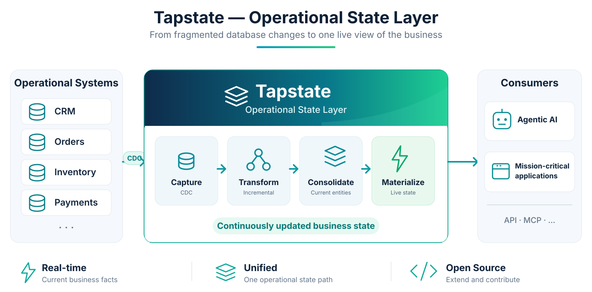
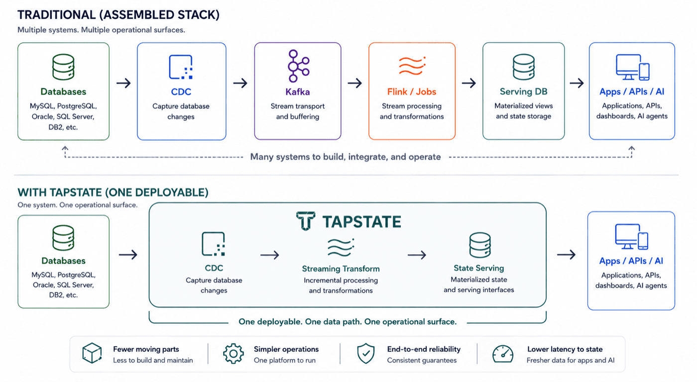

# Tapstate

**From fragmented database changes to one live view of the business.**

Tapstate is an open-source, **operational data engine** that can be used to build a state layer for applications and AI agents. It captures changes from operational databases, incrementally transforms and combines them, and keeps business entities up to date.

**Capture → Transform → Consolidate → Materialize. One deployable.**

[**Try Tapstate in minutes ↓**](#try-it-in-minutes)



*Conceptual architecture: the current Alpha materializes state in MongoDB; stable state-consumption APIs and push delivery are not yet available.*

## Try it in minutes

**Requirements:** Docker with the Compose plugin, and `jq`.

Run this from an empty directory. The installer creates `tapstate-demo/` there and keeps everything inside it:

```sh
curl -fsSL https://install.tapstate.dev/demo | sh
```

It starts a local playground with MySQL, PostgreSQL, MongoDB, and Tapstate. No existing database or Atlas account is needed.

**Administrator credentials.** Nothing is preset: the installer asks you to *choose* a username (Enter accepts `admin`) and a password for the playground's first administrator, then signs in with them. Keep them. You use them to sign in to the web UI, and a re-run in the same directory asks for the same ones. To skip the prompt, set `TAPSTATE_ADMIN_USER` and `TAPSTATE_ADMIN_PASSWORD`. If you lose them, run `docker compose down -v` in `tapstate-demo/`, remove the directory, and start again.

Open **http://127.0.0.1:8080**, sign in, and explore the running pipeline. The installer also writes `tapstate-demo/tapstate-mcp.json`, an MCP configuration you can hand to an AI agent so it can manage the playground's pipelines.

**What you'll see:** MySQL orders and PostgreSQL shipments continuously assembled into live order documents in MongoDB. Change a source record and watch the consolidated state update—without re-running a join or batch job.

[Follow the full quickstart](https://tapstate.dev/docs/overview/quickstart) · [Explore the documentation](https://tapstate.dev/docs)

> **Alpha preview — local evaluation only.** The bundled MongoDB has no authentication, and Tapstate users with tokens can access control-plane data through source declarations. Use non-sensitive data and do not expose the playground to untrusted networks.

## Why operational state?

Enterprise AI needs three complementary kinds of context:

- **Knowledge (RAG):** What does the enterprise know?
- **Agent memory:** What has the agent learned or done?
- **Operational state:** What is true across business systems *right now*?

RAG and memory cannot, on their own, reconcile live orders, customers, payments, inventory, or entitlements scattered across databases. Agents and applications need a **consistent, current view of business entities**, not just access to more tools.

Tapstate focuses on that third context. The same operational state can support traditional applications, APIs, and AI workflows.

## Why Tapstate?

For state-centric workloads, teams often assemble and operate **CDC + Kafka + Flink + a serving database** before applications can consume a consolidated business view.

Tapstate shortens that path with one engine:

- **Capture** — initial load and log-based change data capture (CDC).
- **Transform** — filter, map, join, and reshape changes incrementally.
- **Consolidate** — assemble current business entities across tables and databases.
- **Materialize** — maintain the latest state in MongoDB, the current reference store.




This is a **state path**, not a universal replacement for an event stack. Kafka is valuable for event distribution; Flink is valuable for complex event processing and windowed analytics. 

[Compare Tapstate with a streaming stack](https://tapstate.dev/docs/overview/vs-streaming-stack) · [How Nest assembles live documents](docs/nest/README.md)

## What can you build?

- **AI agents and copilots:** Provide fresh, unified business facts for operational workflows.
- **Customer 360:** Keep one up-to-date view of a customer across systems.
- **Order and fulfillment:** Combine orders, payments, and shipments as they change.
- **Inventory and entitlement:** Maintain current availability and access state.
- **Operational applications:** Reuse the same consolidated state instead of rebuilding joins in every consumer.

## What works today

Tapstate is currently an **open-source Alpha preview**, not a production-ready serving platform.

| Capability | Current scope |
|---|---|
| Sources | MySQL, PostgreSQL, Oracle, SQL Server; Db2 LUW / IBM i in preview; MongoDB |
| Transforms | Filter, map, join (including N:1), unwind, and nest across sources |
| State store | MongoDB (bundled locally, or bring your own MongoDB / Atlas) |
| Management | Web UI, CLI (`.tap.yml`), and MCP for AI-assisted pipeline authoring and operations |
| Observability | Pipeline status, metrics, and logs |

**Current limitations:** No production-grade high availability, exactly-once guarantee, stable State Data API, or push/subscription delivery. Delivery is at-least-once. MCP currently manages Tapstate resources; it is **not** a general-purpose API for agents to query materialized business state.

MongoDB is the current reference implementation for state storage, **not a requirement of the long-term architecture**. Other stores and state-consumption interfaces remain on the roadmap.

[Connector details](https://tapstate.dev/docs/connectors) · [Storage setup](docs/storage/README.md) · [MCP integration](https://tapstate.dev/docs/reference/mcp)

## Next steps

- [Quickstart](https://tapstate.dev/docs/overview/quickstart) — run and modify your first pipeline.
- [Concepts and DSL](https://tapstate.dev/docs/concepts/dsl) — understand sources, resources, and pipelines.
- [Transforms](https://tapstate.dev/docs/reference/transforms) — model live business entities.
- [Architecture](https://tapstate.dev/docs/overview/architecture) — understand the state path.
- [Operate pipelines](https://tapstate.dev/docs/guides/observe-a-pipeline) — inspect health and behavior.
- [Contribute](CONTRIBUTING.md) · [Security](SECURITY.md)

Tapstate is an **Apache-2.0** open-source project from the team behind TapData, built on years of real-time CDC and data integration experience.

